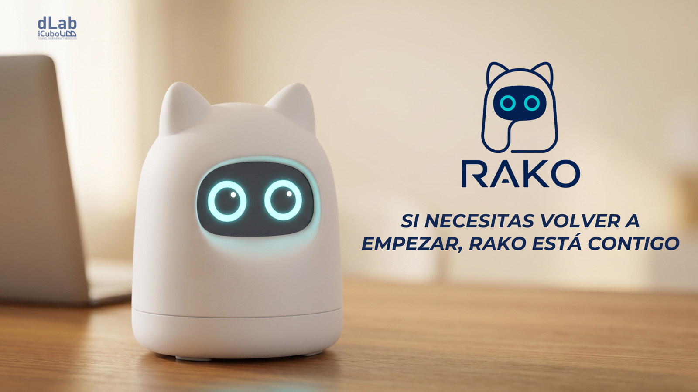
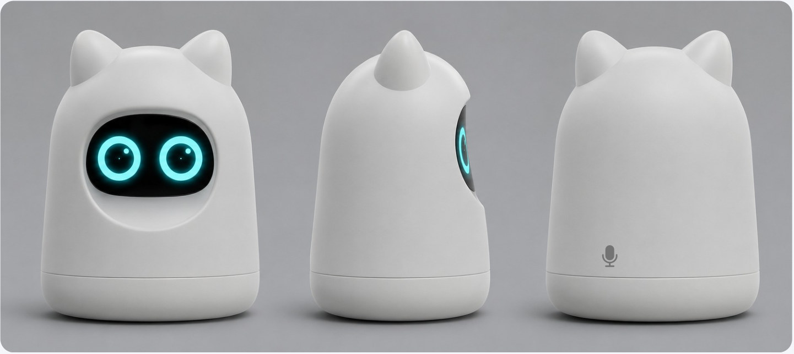
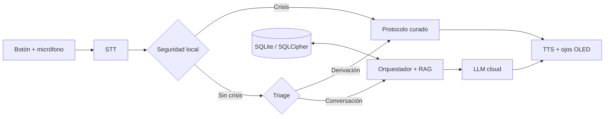

<p align="center">
  
</p>

# Rako · IA física para volver a empezar

**Un pequeño paso. Un poco de foco. Una presencia en tu escritorio.**

Rako es un robot mapache que acompaña a estudiantes universitarios a retomar su rutina con microacciones, sesiones de foco y conversación por voz. Este repositorio contiene el **software que corre en Raspberry Pi**: voz, ojos OLED, memoria local, seguridad y la API para conectar otros canales.

[](https://github.com/yungzyx/rako-pi/actions/workflows/ci.yml)


[Empezar](#setup) · [Ver el proyecto](docs/SHOWCASE.md) · [Arquitectura](#arquitectura) · [Documentación](docs/README.md) · [Contribuir](CONTRIBUTING.md)

> Acompañamiento de rutina y foco, con un alcance no clínico. Rako no diagnostica ni sustituye la ayuda profesional. Las imágenes proceden de la presentación académica del Grupo Mapaches; los renders ilustran el diseño del producto.

## Del escritorio al siguiente paso

| Conversar | Empezar | Sostener |
| --- | --- | --- |
| Un botón activa la conversación por voz, con respuestas y ojos OLED expresivos. | Una intención se convierte en una tarea o un bloque de foco. | El temporizador, el progreso y los check-ins ayudan a retomar la rutina. |



*Render del diseño presentado en el examen. [Explorar prototipos, app y despiece →](docs/SHOWCASE.md)*

## Estado actual

**MVP en Raspberry Pi.** El repositorio incluye conversación por botón, memoria breve, tareas y foco con countdown OLED, API local FastAPI y un canal de WhatsApp con controles de consentimiento y privacidad.

| Disponible en el código | Pendiente o fuera de este repositorio |
| --- | --- |
| Voz con STT, LLM y TTS cloud; RAG local | Reconocimiento emocional de audio (SER) diferido |
| Protocolo de crisis con bypass del LLM; chequeos proactivos opcionales | Cambio atómico de releases OTA todavía manual |
| API móvil, setup y herramientas de fábrica | Conexión real a Firebase; hoy se usa un cliente simulado |
| Memoria editable, modo privado y borrado de datos | App Flutter y vault Obsidian mantenidos por separado |

El hardware documentado usa **Raspberry Pi 4 de 8 GB, ReSpeaker 2-Mics Pi HAT y OLED SSD1306**. La salida de audio actual depende de un parlante externo. Consulta [HARDWARE.md](HARDWARE.md) para el montaje real y [PRODUCT_ROADMAP.md](PRODUCT_ROADMAP.md) para los próximos pasos.

Los chequeos proactivos de la Pi se activan mediante un timer opcional; respetan el modo privado, los horarios silenciosos y los eventos recientes de crisis. [Activación y operación](docs/USAGE.md#chequeos-proactivos-opcionales).

## Arquitectura

La Pi coordina el dispositivo, la persistencia local y las reglas de seguridad. Los servicios cloud aportan transcripción, conversación y síntesis de voz.



**En crisis, el LLM queda fuera del flujo.** Se usan respuestas predefinidas y las rutas de apoyo configuradas. [Arquitectura, servicios y reglas de datos →](docs/ARCHITECTURE.md)

## Setup

### Desarrollo local

Python 3.12 o superior. Las pruebas usan hardware y servicios simulados; no requieren credenciales reales.

```bash
git clone https://github.com/yungzyx/rako-pi.git
cd rako-pi
python3.12 -m venv .venv
source .venv/bin/activate
python -m pip install -r requirements-dev.txt
python scripts/checks.py test
```

Para ejecutar servicios, copia `.env.example` a `.env` y configura los proveedores necesarios. [Guía de desarrollo →](docs/DEVELOPMENT.md)

### Raspberry Pi

Sigue [INSTALL.md](INSTALL.md) para preparar el sistema, las interfaces, el audio y las credenciales. Una vez configurado el dispositivo:

```bash
./scripts/rako-doctor
./scripts/rako-chat
```

## Uso en el dispositivo

```text
Rako, voy a estudiar cálculo 30 minutos
Rako, hazme un pomodoro de 10 minutos para leer papers
Rako, pon música chill
```

Conversación, demos, diagnóstico, respaldo y arranque automático: [guía de uso](docs/USAGE.md).

## API local para la app móvil

```bash
./scripts/rako-api
```

La API escucha en `127.0.0.1:8765` por defecto; su documentación interactiva está en `http://127.0.0.1:8765/docs`. Expone configuración, tareas, foco, memoria, progreso y operaciones de dispositivo. [API, autenticación y contrato OpenAPI →](docs/API.md)

## Canal WhatsApp

Check-ins, acciones de foco, reportes de progreso y memoria editable mediante WhatsApp Business Cloud API. Requiere configurar el canal y el consentimiento del usuario. [Configuración y reglas del canal →](docs/API.md#canal-whatsapp)

## Documentación

| Quiero… | Ir a… |
| --- | --- |
| Entender el producto y ver imágenes | [Galería del proyecto](docs/SHOWCASE.md) · [Historia](PRODUCT_JOURNEY.md) |
| Instalar un dispositivo | [Instalación](INSTALL.md) · [Hardware](HARDWARE.md) |
| Entender el software y el RAG | [Arquitectura](docs/ARCHITECTURE.md) |
| Desarrollar o ejecutar pruebas | [Desarrollo](docs/DEVELOPMENT.md) · [Contribuir](CONTRIBUTING.md) |
| Integrar la app o WhatsApp | [API y canales](docs/API.md) |
| Operar, respaldar o preparar una placa | [Uso](docs/USAGE.md) · [Producción](PRODUCTION_PLAN.md) |
| Revisar alcance y próximos pasos | [Roadmap](PRODUCT_ROADMAP.md) · [Índice completo](docs/README.md) |

```text
rako-pi/
├── src/              Voz, orquestación, seguridad, datos y API
├── tests/            Pruebas con hardware y servicios simulados
├── scripts/          Desarrollo, instalación y operación
├── hardware/         Overlays y configuración física
├── systemd/          Plantillas de servicios y timers
├── knowledge-base/   Contenido de apoyo incluido en el repo
└── docs/             Guías técnicas, galería y recursos visuales
```

## Tests y calidad

```bash
python scripts/checks.py lint
python scripts/checks.py test
python scripts/checks.py safety
python scripts/checks.py hygiene
```

CI exige una cobertura global mínima del **95 %** y ejecuta un job específico para las rutas de seguridad. Ese porcentaje es un umbral, no una medición de la última ejecución. [Detalle de los controles →](docs/DEVELOPMENT.md#tests-y-calidad)

## Privacidad

La base de datos se cifra con SQLCipher fuera de desarrollo. El modo `RAKO_MODE=private` evita persistir el historial de interacciones y el borrado total elimina los datos locales del usuario.

**El flujo de voz utiliza servicios externos:** STT recibe audio para transcribir; el LLM recibe la consulta, fragmentos RAG y contexto limitado; TTS recibe texto para sintetizar. La memoria sensible y los historiales completos permanecen locales. [Reglas detalladas por proveedor](CLAUDE.md#41-privacidad).

## Equipo y créditos

Proyecto académico del **Grupo Mapaches**, dLab / iCubo UDD, 2026-1.

Raimundo Aravena · Yung Chung · Martina Cumsille · Isabel Marín · Tomás Urrutia. Tutor: Juan de Dios Carvajal.

Las imágenes se extrajeron del examen final del equipo, presentado el 9 de julio de 2026. [Procedencia y páginas originales](docs/assets/README.md).

## Licencia

Por definir. Este repositorio todavía no declara una licencia de uso o redistribución.
