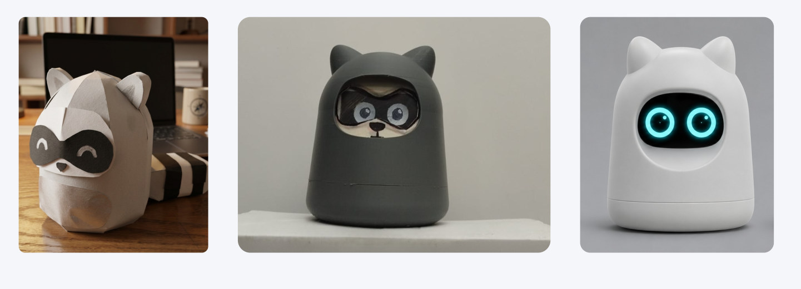
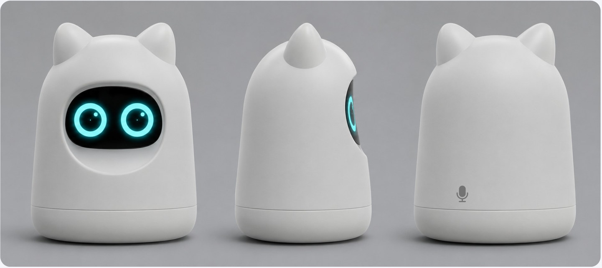
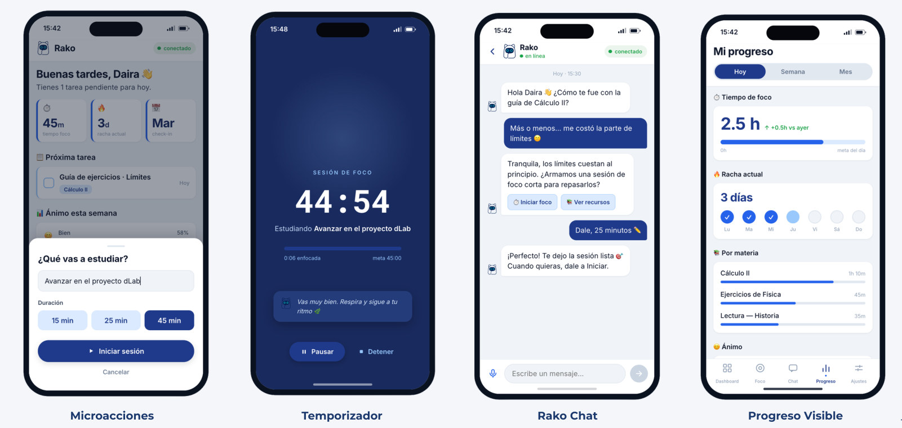
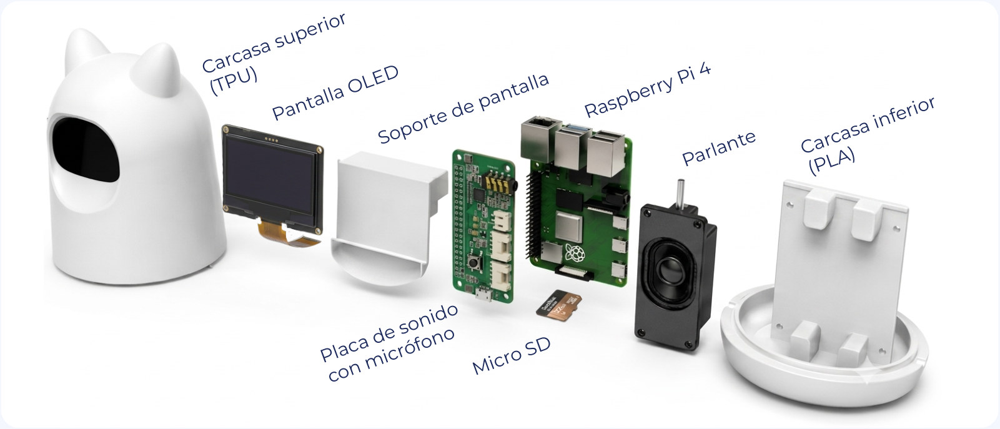

# Rako, del prototipo al escritorio

[Volver al proyecto](../README.md) · [Documentación](README.md)

Una presencia física para acompañar la vuelta a la rutina, un paso a la vez. Esta galería reúne material de la presentación académica del Grupo Mapaches del 9 de julio de 2026.

## Evolución del objeto

La presentación reúne distintas etapas del prototipo y su diseño exterior. Esta secuencia muestra la evolución visual; no certifica el montaje ni las funciones de cada versión. Fuente: página 16 del examen.

## Diseño del dispositivo

Render del diseño presentado en la página 15. El software de este repositorio controla el dispositivo; la configuración física documentada está en [HARDWARE.md](../HARDWARE.md).

## La experiencia móvil

Pantallas presentadas en la página 17 del examen. Ilustran la experiencia complementaria del producto; la app Flutter se mantiene fuera de este repositorio. Aquí se implementa la [API local](API.md) que permite integrar esos flujos.

## Qué hay dentro

Despiece ilustrativo de la página 24. El montaje actual documentado utiliza un parlante externo; esta imagen representa el diseño del producto y no sustituye la guía de hardware.

## Procedencia

Las imágenes son capturas del PDF proporcionado por el equipo, exportadas y optimizadas para GitHub. No se generaron nuevas imágenes. Los recortes eliminan la navegación de las diapositivas para priorizar el producto. Consulta el [registro de recursos](assets/README.md) para sus páginas y dimensiones.
